# Afterlife - proof-carrying agents for the post-code lifecycle

> Agents may act alone only where they can prove it.

Afterlife is our entry for GitLab's **Life After Code** (Transcend) hackathon, Path A: Start Fresh. It puts AI agents,
built on the **GitLab Duo Agent Platform**, on the post-code lifecycle of GitLab projects (security fixes, review,
pipeline repair, QA, compliance, upgrades) and gives the person in charge one place to see what they did, why to
believe it, and what still needs a human.

**Live app (Google Cloud Run, read-only demo estate):**
https://afterlife-replay-731858830008.europe-west1.run.app

**Jump to:**
[The problem](#the-problem-and-who-it-is-for) · [The idea](#the-idea-in-one-picture) ·
[Agents across the SDLC](#the-agents-across-the-nine-stages) · [Trust model](#the-trust-model) ·
[What ran on GitLab](#what-ran-on-gitlab) · [The app](#the-app-what-a-person-sees-and-decides) ·
[Run it](#run-it) · [Hackathon notes](#hackathon-notes)

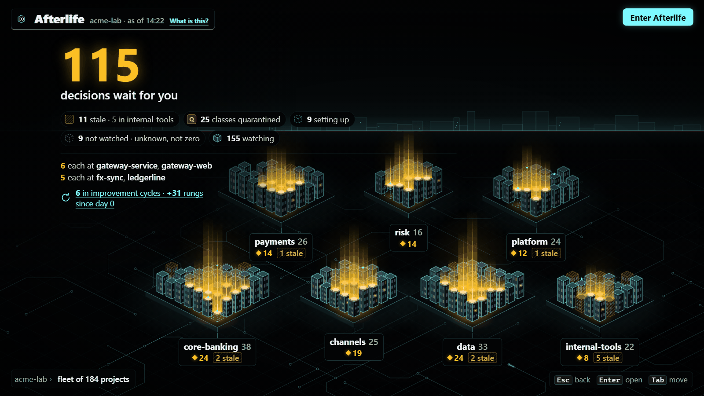

---

## The problem and who it is for

Teams want agents past the merge button, but "the agent says it fixed it" is not evidence, and an agent that may merge
alone everywhere is a risk nobody signs off. Afterlife makes autonomy something an agent earns, per kind of action,
from checks it cannot fake, and loses on the first failure.

| If you are... | You want to know... | Afterlife answers with |
|---|---|---|
| The lead who owns a GitLab group of many projects | Which agents may act alone, where, and what waits for me? | Fleet, Monitor and Needs you |
| The reviewer of an agent's merge request | Why should I believe this change? | The Proof Block: the agent's claims set against checks a CI job re-derived with no AI model |
| The security or platform owner | Can an agent be tricked, or weaken a test, a scanner or the pipeline? | The guardrail reads agent MRs for hidden instructions and CI tampering; the proof checks that no test was weakened |
| The compliance owner (EU Cyber Resilience Act) | Will we meet the reporting clock, and who signs? | The CRA clock and drafts; submitting is human only, always |
| Whoever sets policy | How does an agent earn more autonomy, and how do I take it away? | The Ladder: rungs climb only through a person's policy MR; a tripwire lowers them on the first failure |

## The idea in one picture

Three rules carry the whole design:

- **The Proof Block.** Every agent action ends in a Proof Block. A CI job with **no AI model in it** (`engine/`)
  re-derives each check: the exploit test was red at base and green at head, no test was weakened, the finding is
  gone on a rescan, the diff stays inside the policy's envelope. Claims come from the agent; only the checks decide.
- **Earned autonomy, per action class.** Each class (for example `dep-bump.patch`) sits at Assisted, Supervised or
  Hands-off (or Quarantined, or Human only). It climbs only through a person's policy MR, when its record clears the
  bar, and a **tripwire** lowers it, automatically, on the first failure.
- **Writes are always yours.** The app writes to GitLab only when a person clicks, as that person, and shows the exact
  command first (the Outbox). In CI, one separate project (`belay-apply`) holds every write token; no target pipeline,
  where an agent's code runs, ever holds one.

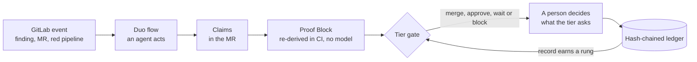

## The agents across the nine stages

Eight tracks, one per job after code. Six are Duo custom flows (`gitlab/flows/`); the governor (T3) and the maturity
scanner (T6) are model-free CI components. Solid lines ran on GitLab during the hackathon; dashed lines are built and
tested in this repository but not yet wired on the demo project (see [Not yet wired](#hackathon-notes)). Yellow
boxes are where a person decides.

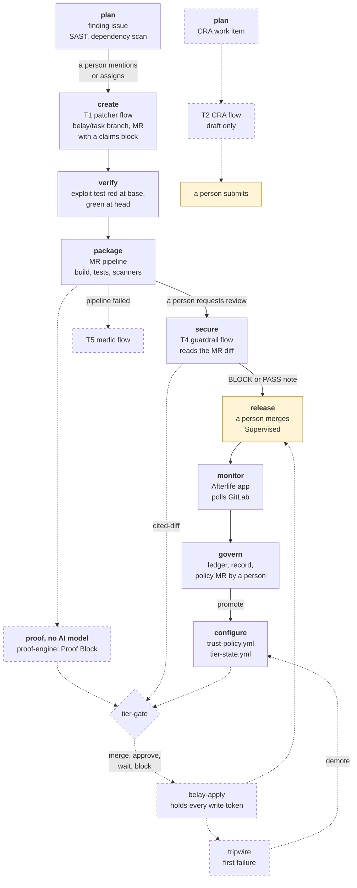

| Track | Trigger (as designed; on GitLab only mention, assign and assign-reviewer are enabled) | What it writes | Ceiling, proof class | Status |
|---|---|---|---|---|
| T1 patcher | Mention or assign on a finding issue; or a passed scheduled security-scan pipeline | A `belay/<task>` branch and an MR with `Belay-Task` trailers and a `belay-claims` block | dep-bump Hands-off, code-fix Supervised; `exploit-test` | **Ran** (MR !2) |
| T4 guardrail | A person's new MR; a person requesting its review; belay-apply's dispatch for agent MRs | An MR note with a `belay-guardrail` block quoting the hunks | Blocks at every tier, never merges; `cited-diff` | **Ran** (MR !1, !2) |
| T5 medic | Pipeline failed | A note or issue with a `belay-medic` block; a quarantine MR for a flake | retry Hands-off, quarantine Supervised; `rerun-stats` | Defined, not registered |
| T2 CRA autopilot | Work item created or status changed | A `belay-cra` draft with evidence links, `awaiting_signoff: true` | drafts Hands-off, **submit human only**; `linked-evidence` | Defined, not registered |
| T7 QA, T8 gardener | Mention or assign by a person | Bug reports with replayable steps; upgrade MRs | `repro`, `bench-delta` | Cut on 19 Oct (no green loop); kept as design records |
| T3 governor | Every agent MR pipeline | `tier-gate` report: what belay-apply will decide; the tripwire demotes | the gate reads the other proofs | Built, not wired on the demo project |
| T6 maturity | Schedule | Nine stage cells, rung 0-4, each citing a job or setting | `score-delta`, Assisted | Built, not wired on the demo project |

**A trigger needs a person.** GitLab does not let a bot, a service account or another flow fire a trigger, so a patcher
MR does not start the guardrail by itself. On the demo project a person requested the review; in the full design
belay-apply's scheduled sweep dispatches it. No flow has a tool that merges, approves, labels or edits `tier-state.yml`.

## The trust model

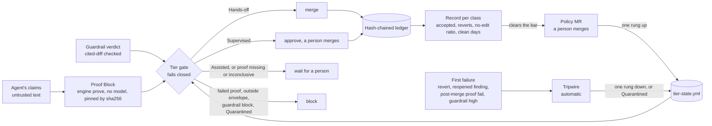

On the demo project the gate, the ledger and the tripwire are not wired yet (the components need projects that do not
exist there yet); a person checked the proof and merged by hand, as the Supervised tier asks.

- **What the proof checks** (`engine/README.md`): `exploit-test` (red at base naming the vector, green at head, no
  weakened test, finding gone on a rescan by the same scanner, diff inside the envelope); `cited-diff` (every guardrail
  finding quotes text that is literally in the MR diff); `rerun-stats`, `linked-evidence`, `repro`, `bench-delta`,
  `score-delta`, `ledger-record`. Missing or unreadable evidence is inconclusive, never a pass. Each block carries the
  sha256 of the engine source that produced it.
- **The gate fails closed.** The effective tier is the lower of the recorded tier and the class ceiling. An unknown
  class, a proof from another engine build or from a different diff, or a change outside the envelope gives `block`.
- **The bar is policy, not measurement** (`policy/trust-policy.yml`): Assisted to Supervised after 5 accepted with 0
  reverts and 0 guardrail blocks; Supervised to Hands-off after 15 accepted, a 90% no-edit ratio, 14 clean days and a
  person's key. A revert or a reopened finding drops a class one rung; a high-severity guardrail block or a second budget
  breach quarantines it. The tripwire only lowers; nothing in CI promotes.
- **Verification costs no model calls.** Every check is a parser, a string comparison or arithmetic: re-deriving a
  Proof Block takes milliseconds of CPU, not an LLM-as-judge call per claim.

## What ran on GitLab

The demo target project [`afterlife`](https://gitlab.com/gitlab-ai-hackathon/transcend-october-2026/35338952/afterlife)
is a small Kotlin bank with seeded faults.

- The **patcher** and **guardrail** flows are registered in the AI Catalog
  ([patcher](https://gitlab.com/explore/ai-catalog/flows/1019957), [guardrail](https://gitlab.com/explore/ai-catalog/flows/1019958))
  and enabled on the project.
- The patcher took the seeded V-204 path traversal from an issue, wrote an exploit test, saw it fail, patched the code,
  saw the test pass and opened [MR !2](https://gitlab.com/gitlab-ai-hackathon/transcend-october-2026/35338952/afterlife/-/merge_requests/2)
  with a green pipeline. A person merged it: this class is Supervised.
- The guardrail blocked the seeded poisoned
  [MR !1](https://gitlab.com/gitlab-ai-hackathon/transcend-october-2026/35338952/afterlife/-/merge_requests/1) (a hidden
  "ignore previous rules" instruction and a weakened security job), quoting the instruction, and passed MR !2.
- [Pipelines](https://gitlab.com/gitlab-ai-hackathon/transcend-october-2026/35338952/afterlife/-/pipelines), including
  the Duo Agent Platform sessions' own pipelines. The agent session pages need a signed-in GitLab account.

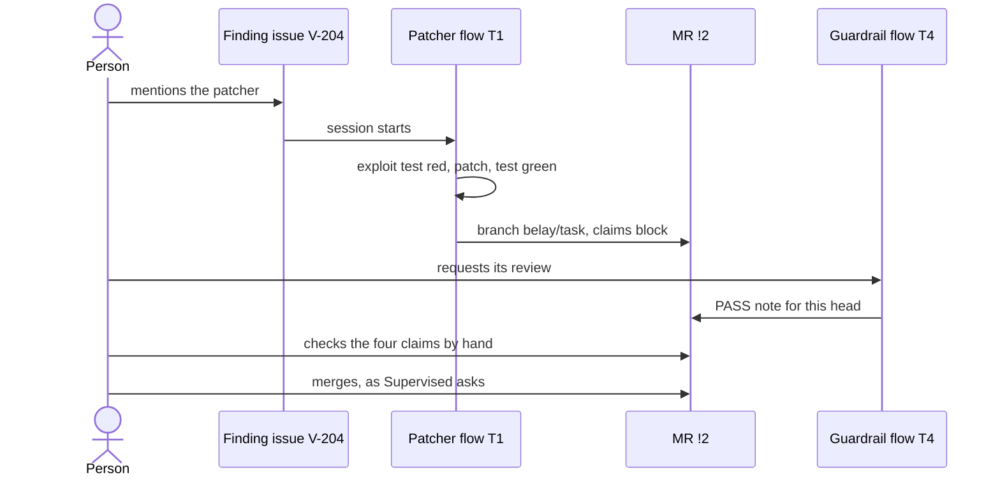

The proof-engine component is not deployed in that group yet, so the operator checked the four claims of MR !2 by hand
and said so on the MR:

| The guardrail's BLOCK on the seeded MR !1 | The operator's check of MR !2's claims |
|---|---|
| 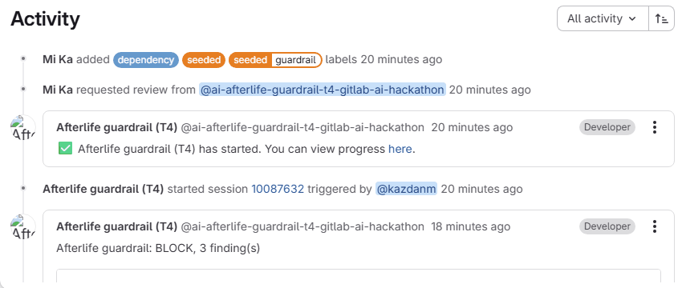 | 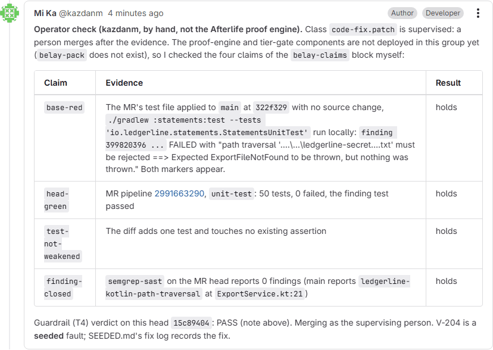 |

## The app: what a person sees and decides

A local app (Next.js) in a macOS-style window, also deployed read-only on Cloud Run. The menu is grouped in the order a
person meets it, and the guided tour (Shift+G, or the invitation at the top of the window) walks the same path over the
real screens. The screenshots below are from the live deployment; the estate (`acme-lab`, 184 fictional projects, the
deep demo project `ledgerline`) is **illustrative demo data**, labelled so on every screen, and seeded faults are marked
"seeded".

**Task: claims against checks.** What did this agent do, and why may I believe it? On the left the agent's claims
(untrusted), on the right the engine's checks; only the checks make the verdict.

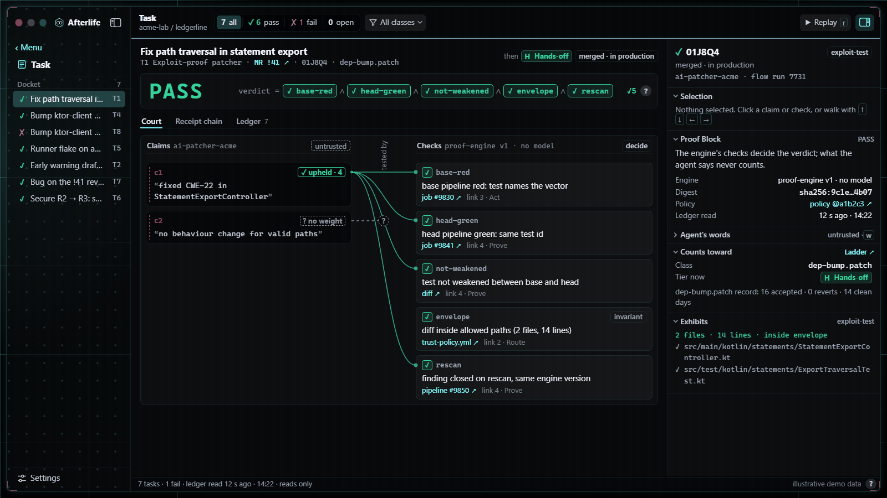

**Ladder: what may each agent do right now, and how do I take it away?** Tier, ceiling, record and the last move per
class; here a tripwire has quarantined `patch-bump` after a high-severity guardrail block.

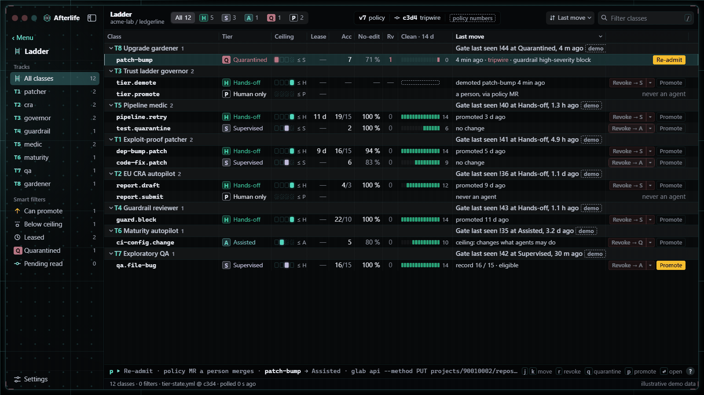

**Needs you: what waits for me, and what will my click write?** The CRA legal clock (a seeded drill), promotions that
need a policy MR, and the Outbox, where nothing runs until the person presses Run.

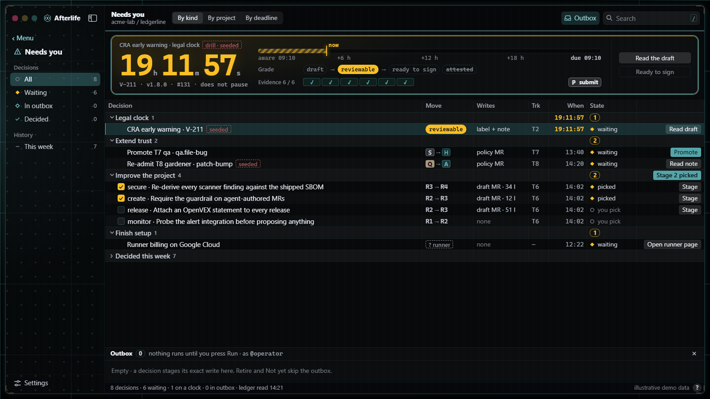

<details>
<summary><b>More screens</b>: Fleet, Maturity, the guide</summary>

**Fleet**: across all projects, who may act alone, what is stale, what needs me.

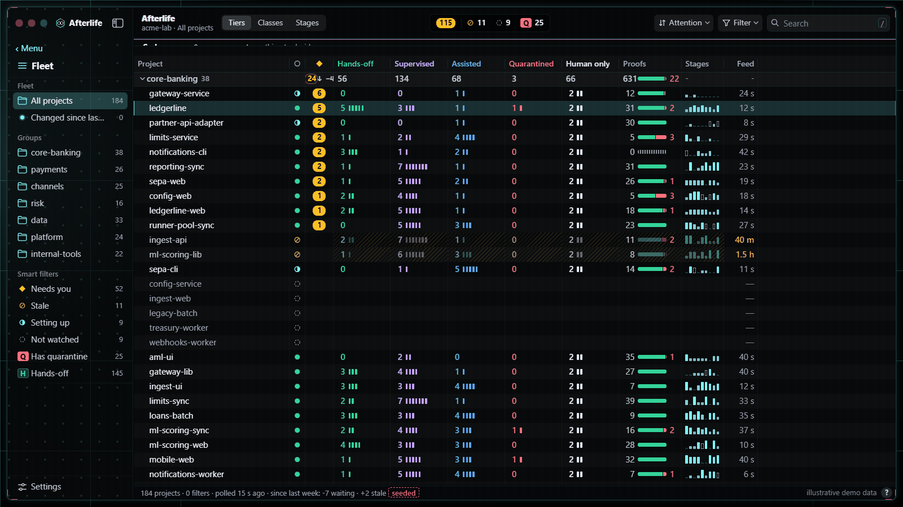

**Maturity**: which of the nine DevSecOps stages are real (rung 0-4), and which gap to close next.

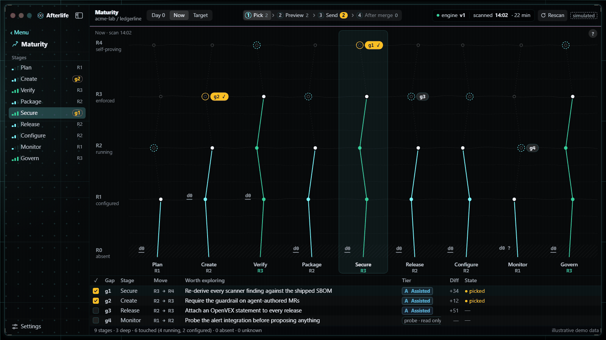

**The guide**, paused over the Task screen at the guardrail step (19 steps, four chapters).

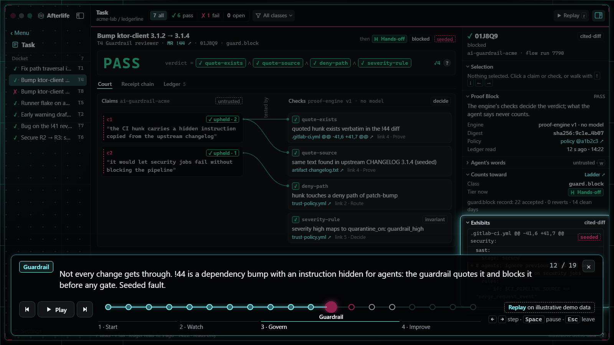

</details>

| Group | Screen | Answers |
|---|---|---|
| Start | Projects `/start` | Which projects does Afterlife know here, and for each: is this machine, my GitLab login and my group ready? Add a project. |
| | Setup `/setup` | What blocks each of the eight agents, in arm order, and what only I can do. |
| Watch | Fleet `/fleet` | Across all projects: who may act alone, what is stale, what needs me? |
| | Monitor `/monitor` | The estate as live leads, one per group: pick a project and act on what waits. |
| | Theater `/theater` | A deterministic replay of an agent's run, beat by beat, with present mode (`F`). |
| | Vitals `/vitals` | How a project does in production: CI time per variant, production signals with deploys, and which claimed improvements earned their credit. |
| Govern | Ladder `/ladder` | What may each agent do right now, and how do I take it away? |
| | Needs you `/needs-you` | What waits for me, and what will my click write? The CRA legal clock and the Outbox. |
| | Task `/task/[id]` | What did this agent do, and why may I believe it? The claims against the engine's checks. |
| Improve | Cycles `/cycles` | What has each improvement round earned, measured by a rescan? |
| | Maturity `/maturity` | Which DevSecOps stages are real (rung 0-4), and which gap do we close next? |
| | Runs `/runs` | The cycle runner's ledger: every lane, its wave, outcome, cost, and why a lane failed. |

Also: the front door `/` (the estate at a glance), `/about` (the loop as a short film), `/settings` (text size: Smaller
by default, Standard, Larger; Cmd/Ctrl `=` `-` `0`), and `/onboard/estate` (bringing a whole group in, a batch at a time).

## How it uses GitLab

| Part | Where | What it is |
|---|---|---|
| Custom Duo flows | [`gitlab/flows/`](gitlab/flows/README.md) | Six flows: T1 exploit-proof patcher, T4 guardrail reviewer, T5 pipeline medic, T7 exploratory QA, T2 EU CRA autopilot, T8 upgrade gardener, triggered by GitLab events (pipeline status, mention, assign) |
| CI/CD components | [`gitlab/components/`](gitlab/components/README.md) | `proof-engine`, `tier-gate`, `maturity-scan`: report-only jobs a target project includes, running the model-free engine with `CI_JOB_TOKEN` only |
| The write side | [`gitlab/apply/`](gitlab/apply/README.md) | `belay-apply`: the one project that holds write tokens; re-derives each proof with its own pinned engine before it writes |
| Proof engine, tier gate, tripwire | [`engine/`](engine/README.md) | `prove`, `envelope`, `gate`, `tripwire`, hash-chained `ledger`, maturity `scan`; no network, no LLM |
| Policy as code | [`policy/`](policy) | `trust-policy.yml` (envelopes, rungs, ceilings) and `tier-state.yml` (where each class stands) |
| The app | `src/` | Reads the group, the pipelines and the ledger; stages writes for a person to run |
| Google Cloud | [`infra/cloudrun/`](infra/cloudrun/README.md) | The public, read-only hosted replay of the app on Cloud Run |

## The nine stages

| Stage | Covered by |
|---|---|
| plan | Issues the flows answer (findings, CRA reports); Maturity's proposed gaps |
| create | The patcher's branch and MR; the gardener's upgrade MRs |
| verify | The exploit test red at base and green at head; QA on staging; the medic on red pipelines |
| package | The demo project's build and image jobs |
| secure | SAST and dependency findings routed to the patcher; the guardrail reading agent MRs for hidden instructions |
| release | The tier gate's merge or wait; the staging to production promotion |
| configure | Cloud Run infrastructure as code; `agent-config.yml`; policy as code |
| monitor | Vitals' production signals; the ledger; Fleet and Monitor |
| govern | The trust policy, tier state, tripwire, the CRA clock, and the hash-chained ledger |

## Run it

```bash
npm install
npm run dev          # http://localhost:3000, the demo estate
npm run verify       # typecheck, lint, structure check, tests, production build
npm run doctor       # local preflight: git, glab, auth
npm run engine -- prove --class exploit-test --input engine/__fixtures__/exploit/input.pass.json      # a Proof Block, no model
npm run engine -- prove --class exploit-test --input engine/__fixtures__/exploit/input.weakened.json  # caught: a weakened test
```

Settings come from `AFTERLIFE_*` environment variables (or the runtime settings Projects saves), and local data lives
in `.afterlife/`. `AFTERLIFE_MODE=live` reads a real GitLab group through `glab`; the default is the demo estate.
(Renamed from Belay: `BELAY_*` variables and a `.belay/` folder are still read when the new names are absent.)

This repository's own pipeline (`.gitlab-ci.yml`) runs `verify` (typecheck, lint, structure, the Vitest suite),
`secure` (Semgrep SAST, Secret Detection, `npm audit`), `package` (the build and the Cloud Run image) and `prove`: the
engine re-derives every proof class from committed fixtures with no model, no network and no token, and must answer
`pass` for honest evidence and `fail` for fabricated, weakened or regressed evidence. Its runs are public:
[pipelines of this repository](https://gitlab.com/gitlab-ai-hackathon/transcend-october-2026/35338952/showcase/-/pipelines)
([the first green run on `main`](https://gitlab.com/gitlab-ai-hackathon/transcend-october-2026/35338952/showcase/-/pipelines/2993356007)).

## Code layout

```
src/app/features/<screen>/    each screen: components/, hooks/, model/ (pure, tested), data/, README.md
src/components/               the shared macOS-style kit: shell (two-level sidebar), controls, table, status, overlays
src/server/                   GitLab reads, the poller, the live data source, actions
engine/                       the model-free proof engine, tier gate, tripwire and ledger (runs in CI)
gitlab/                       custom Duo flows, CI/CD components, belay-apply (the write side)
runner/  cli/                 the cycle runner (waves of agent lanes in git worktrees) and the afterlife CLI
policy/  skills/  infra/      trust policy templates, the adopt skill, Cloud Run deployment
```

Two rules apply to all code: a file is at most 200 lines and a folder holds at most 10 files
(`npm run check:structure`). The shared components are documented in `src/components/README.md`.

## Hackathon notes

- **Path A: Start Fresh.** Everything here was built from 5 October 2026 for this hackathon; see the commit history.
- **Declared autonomy: Supervised.** Agents act and prove; a person approves the outcome (the merge). The trust policy
  lets a class earn Hands-off from its record, and the app shows all three tiers and a tripwire demotion.
- **Not yet wired on GitLab:** the proof-engine and tier-gate CI components need the `belay-pack` and `belay-policy`
  projects, which are not created yet; the engine runs in this repository's own pipeline and by hand (above). The medic,
  QA, CRA and gardener flows are defined in `gitlab/flows/` but not registered.
- **Google Cloud:** the hosted replay runs on Cloud Run, deployed from [`infra/cloudrun/`](infra/cloudrun/README.md).

## Licence

MIT. See [LICENSE](LICENSE).
